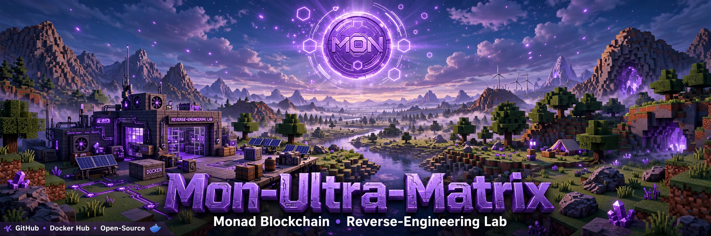

https://labs.google/fx/tools/flow/shared/video/0ba4b2a6-cfc2-4f46-bad6-b1815c80506b

# Mon-Ultra-Matrix

## 🧰 Tech Stack & Architecture Badges

## 💻 Core Programming Languages & Core Systems

## ⛓️ Web3 & Blockchain Infrastructure

## ⚙️ Platform Support & Hardware Architecture

## ⚡ Low-Level Infrastructure & Performance

## 🛠️ DevOps & Build Tools

## ☁️Cloud Provider

-----

(Architecture: one pure-Python package (`src/mon_ultra_matrix/`, 30 modules) - EVM/ABI reverse engineering, Monad contract audit, tx forensics, RPC inspection, ISO/IEC standards audit, a Gemini Pro Thinking (Extended) agent planner, and a matrix test runner - shipped as a single Docker image with a Docker Compose fleet stack for the 10 merged credkellar images.)

> Mon-Ultra-Matrix: Monad reverse-engineering lab merging 7 GitHub repos and 10 Docker Hub images into unified system. EVM bytecode and ABI RE, contract audit, tx forensics, RPC inspection and ISO/IEC standards checks, run by a Gemini Pro Thinking Extended planner sizing 58 zero-latency agents - per repo and unified. Successes only, failures removed.

**Monad reverse engineering, merged perfectly.** Experimenting, testing, learning, deploying - **successful projects only: all failures removed.**

Mon-Ultra-Matrix is a pure-Python (stdlib-only) reverse-engineering lab for Monad - the EVM-compatible Layer 1 doing 10,000 TPS with ~0.4s blocks and ~0.8s finality (MonadBFT, RaptorCast, MonadDb, parallel execution). It merges seven ddkellar01 projects and ten credkellar Docker Hub images into one coherent lab - see [docs/MERGE_MAP.md](docs/MERGE_MAP.md) for exactly where each one lives.

## The merge - 7 GitHub repos (ddkellar01)

| Source | Lives here as |
|---|---|
| Autonomous-Tech-Infrastructure-Platform | scout + sandbox + deployer |
| ISO-IECx | standards audit (`standards.py`) |
| IvyTech-Nexus-Omni-Institution | curriculum + learner KB |
| Crypto-Recovery-Forensics | tx tracing + forensics |
| Google-FlowX | Ultra-Matrix runner (all checks x all targets) + Gemini planner |
| WEB3-insp3ct | RPC / contract inspector |
| quantum-ecosystem | Monad contract auditing (EVM + ABI RE) |

## Second merge - 10 Docker Hub images (credkellar)

Verified live 2026-10-27, 6,699 pulls total: deconstruction (668), vulnerabilitiesx (751), bug-bounty-xterminator (1,852), monad-vul-x (424), malware-sandbox-suite (227), app-data-compressor (251), honeyroot-x (266), malware-research-hub (108), globe-visualizer-frontend (1,009), globe-visualizer-backend (1,143). Each one is a native module here (`docker_images.py` is the registry) and the whole fleet runs from `docker-compose.ultra.yml`. Full map: [docs/MERGE_MAP.md](docs/MERGE_MAP.md)

| Docker Hub image | Module |
|---|---|
| deconstruction | `deconstruction.py` - strip contracts/systems to core logic |
| vulnerabilitiesx | `vuln_scan.py` - vulnerable-vs-secure patterns, OWASP lab |
| bug-bounty-xterminator | `bounty.py` - scope -> triage -> report, scope-guarded |
| monad-vul-x | `contract_audit.py` - Monad contract audit + parallel-execution notes |
| malware-sandbox-suite | `malware_sandbox.py` - static triage only, never executes a sample |
| app-data-compressor | `compressor.py` - content-defined chunking, dedup, compression |
| honeyroot-x | `honeypot.py` - SSH brute-force log analysis |
| malware-research-hub | `malware_research.py` - IOC extraction + sample catalog |
| globe-visualizer-frontend | `globe.py` - payload consumer + render snippet |
| globe-visualizer-backend | `globe.py` - points/arcs payload builder |

# The 58 Agents - Gemini Pro Thinking (Extended) breakdown

Source of truth: `src/mon_ultra_matrix/gemini_planner.py` (from Google-FlowX, the Gemini Pro Thinking repo in the merge). Gemini Pro (`gemini-2.5-pro`, extended thinking, thinkingBudget 32768) decomposes each repo's work into a subtask graph; the deterministic planner levels the graph and recommends **agents = the widest parallel level**. At that width queue wait is **0 ms** and wall-clock collapses to the critical path. More agents buy nothing; fewer add queue wait.

**Unified Mon-Ultra-Matrix = 58 agents** - all 17 pipelines at once, each at its own zero-latency width: 3+3+4+3+4+4+3+3+4+5+5+2+4+3+3+3+2 = 58. Reusing one pool of 5 serially also works, with queue wait.

Mon-Ultra-Matrix — Mermaid flowcharts for EVERY file (48 of 48)
1/48 — .github/workflows/ci.yml

flowchart TD
    A["Trigger: push or pull_request"] --> B["Job test on ubuntu-latest"]
    B --> C["actions/checkout v4"]
    C --> D["setup-python v5: Python 3.12"]
    D --> E["pip install -e . plus pytest"]
    E --> F["pytest -q: 29 tests"]
    F --> G{"Tests pass?"}
    G -->|no| H["CI red - stop"]
    G -->|yes| I["python scripts/smoke.py"]
    I --> J{"Smoke OK?"}
    J -->|yes| K["CI green"]
    J -->|no| H

2/48 — .github/workflows/docker-publish.yml

flowchart TD
    A{"Trigger?"} -->|push to main| B["Job publish on ubuntu-latest"]
    A -->|push tag v star| B
    A -->|workflow_dispatch manual| B
    B --> C["actions/checkout v4"]
    C --> D["docker/setup-buildx-action v3"]
    D --> E["docker/login-action v3: DOCKERHUB_USERNAME + DOCKERHUB_TOKEN secrets"]
    E --> F["docker/build-push-action v6: build root Dockerfile, push true"]
    F --> G["Tags: latest + commit SHA"]
    G --> H["Image live on Docker Hub"]

3/48 — src/mon_ultra_matrix/__init__.py

flowchart TD
    A["Package imported"] --> B["Set __version__ = 0.1.0"]
    B --> C["Export __all__: version only"]

4/48 - src/mon_ultra_matrix/__main__.py

flowchart TD
    A["python -m mon_ultra_matrix"] --> B["Import main from cli.py"]
    B --> C["Run main with argv"]
    C --> D["sys.exit with main return code"]

5/48 - src/mon_ultra_matrix/abi_re.py

flowchart TD
    A["Input: 4-byte selectors"] --> B{"identify: selector in KNOWN DB?"}
    B -->|yes| C["Return signature, e.g. transfer address uint256"]
    B -->|no| D["Return unknown"]
    A --> E["identify_all: map every selector"]
    A --> F{"is_erc20: transfer + transferFrom + balanceOf + totalSupply all present?"}
    F -->|yes| G["True: ERC-20 interface"]
    F -->|no| H["False"]

6/48 - src/mon_ultra_matrix/bounty.py

flowchart TD
    A["Target + allowlist"] --> B{"in_scope: exact, subdomain, or prefix match?"}
    B --> C{"triage: in scope?"}
    C -->|no| D["Drop - out of scope, score 0.0"]
    C -->|yes| E["Score by severity: critical 9.0 to info 0.5"]
    E --> F["report_scaffold: title, target, steps, impact, remediation"]

7/48 — src/mon_ultra_matrix/cli.py

flowchart TD
    A["main: parse subcommand"] --> B{"Which command?"}
    B -->|stats| C["monad_stats summary + protocols + tokenomics JSON"]
    B -->|images| D["docker_images registry + total pulls JSON"]
    B -->|agents| E{"--repo given?"}
    E -->|yes| F["gemini_planner recommend_for_repo"]
    E -->|no| G["gemini_planner recommend_all - the 58"]
    B -->|analyze| H["evm_re analyze bytecode"]
    H --> I["Add signatures, is_erc20, risk flags, standards score + audit"]
    B -->|experiment| J["ProjectRegistry + pipeline run"]
    J --> K{"--fail flag?"}
    K -->|yes| L["Run 1/0 - failure removed by registry"]
    K -->|no| M["Run ok lambda - success recorded"]
    B -->|registry| N["Registry summary JSON"]
    B -->|reason| O["learner reason over offline KB"]
    C --> Z["Print JSON, return 0"]
    D --> Z
    F --> Z
    G --> Z
    I --> Z
    L --> Z
    M --> Z
    N --> Z
    O --> Z

8/48 — src/mon_ultra_matrix/compressor.py

flowchart TD
    A["Input: bytes"] --> B["chunk: split into 4096-byte chunks"]
    B --> C["dedup_chunks: SHA-256 each chunk"]
    C --> D{"Hash seen before?"}
    D -->|yes| E["Skip duplicate"]
    D -->|no| F["Keep chunk, record hash"]
    E --> G["Join unique chunks"]
    F --> G
    G --> H["compress: zlib level 9 + ratio metadata"]
    H --> I["decompress: zlib restore original"]
    
## The 58 - widest-level roster (the payload moment)

The exact agents working simultaneously when every pipeline hits its widest level - the moment the number 58 describes. Everything else in each pipeline runs before or after this level, in dependency order.

### Autonomous-Tech-Infrastructure-Platform - 3 agents (level 0)

- **1. `scout-github`** (300 ms) - Scout open-source repos on GitHub. Analysis: Stars/activity/licence fit scoring. Payload: topic query -> ranked repo list.
- **2. `scout-defillama`** (300 ms) - Scout protocols on DefiLlama. Analysis: TVL, fees, chain distribution. Payload: chain filter -> protocol metrics.
- **3. `scout-docs`** (300 ms) - Scout documentation and specs. Analysis: Doc completeness + API surface extraction. Payload: doc URLs -> spec notes.

### ISO-IECx - 3 agents (level 0)

- **4. `crawl-iso`** (400 ms) - Crawl ISO standard material. Analysis: Clause extraction. Payload: ISO sources -> clause set.
- **5. `crawl-iec`** (400 ms) - Crawl IEC standard material. Analysis: Clause extraction. Payload: IEC sources -> clause set.
- **6. `crawl-owasp`** (400 ms) - Crawl OWASP guidance. Analysis: Control + test-case extraction. Payload: OWASP sources -> control set.

### IvyTech-Nexus-Omni-Institution - 4 agents (level 1)

- **7. `build-curriculum`** (500 ms) - Build the curriculum. Analysis: Topic sequencing + learning objectives. Payload: corpus -> curriculum.
- **8. `build-kb`** (500 ms) - Build the knowledge base. Analysis: Chunking + indexing for retrieval. Payload: corpus -> KB index.
- **9. `build-labs`** (500 ms) - Build hands-on labs. Analysis: Exercise design from corpus topics. Payload: corpus -> lab set.
- **10. `build-assessments`** (500 ms) - Build assessments. Analysis: Question generation + answer keys. Payload: corpus -> assessment set.

### Crypto-Recovery-Forensics - 3 agents (level 1)

- **11. `utxo-trace`** (500 ms) - Trace UTXO flows. Analysis: Address clustering + hop graph. Payload: tx dataset -> UTXO graph.
- **12. `evm-trace`** (500 ms) - Trace EVM flows. Analysis: Internal calls, token transfers, counterparty map. Payload: tx dataset -> EVM graph.
- **13. `key-derivation-analysis`** (500 ms) - Analyse key derivation. Analysis: BIP39/BIP32 path + entropy checks (educational). Payload: seed-path data -> derivation report.

### Google-FlowX - 4 agents (level 1)

- **14. `render-chunk-1`** (800 ms) - Render film chunk 1. Analysis: NNL/ML parallel rendering, segment 1. Payload: storyboard -> frames 1.
- **15. `render-chunk-2`** (800 ms) - Render film chunk 2. Analysis: NNL/ML parallel rendering, segment 2. Payload: storyboard -> frames 2.
- **16. `render-chunk-3`** (800 ms) - Render film chunk 3. Analysis: NNL/ML parallel rendering, segment 3. Payload: storyboard -> frames 3.
- **17. `render-chunk-4`** (800 ms) - Render film chunk 4. Analysis: NNL/ML parallel rendering, segment 4. Payload: storyboard -> frames 4.

### WEB3-insp3ct - 4 agents (level 1)

- **18. `inspect-rpc`** (400 ms) - Inspect the RPC surface. Analysis: Chain ID, block height, method exposure. Payload: target -> RPC findings.
- **19. `inspect-dom`** (400 ms) - Inspect the DOM / frontend. Analysis: Script + wallet-hook analysis. Payload: target -> DOM findings.
- **20. `inspect-network`** (400 ms) - Inspect network behaviour. Analysis: Endpoints, websockets, data flows. Payload: target -> network findings.
- **21. `inspect-mobile`** (400 ms) - Inspect the mobile surface. Analysis: Deep links + app endpoints. Payload: target -> mobile findings.

### Quantum-Ecosystem - 3 agents (level 1)

- **22. `monad-contract-audit`** (600 ms) - Audit Monad contracts. Analysis: Full Monad-Vul-X scan set + parallel-execution notes. Payload: bytecode -> audit findings.
- **23. `sandbox-detonation`** (600 ms) - Sandbox detonation (planned, isolated). Analysis: Behaviour observation plan - never on host. Payload: candidate -> behaviour notes.
- **24. `fund-balancer`** (400 ms) - Balance fund flows (analysis only). Analysis: Flow in/out reconciliation. Payload: tx data -> balance sheet.

### Deconstruction - 3 agents (level 1)

- **25. `decompose-frontend`** (400 ms) - Decompose the frontend. Analysis: Component tree + framework detection. Payload: inventory -> frontend map.
- **26. `decompose-backend`** (400 ms) - Decompose the backend. Analysis: Services, APIs, data stores. Payload: inventory -> backend map.
- **27. `decompose-logic`** (400 ms) - Decompose the core logic. Analysis: Business rules + invariants. Payload: inventory -> logic map.

### VulnerabilitiesX - 4 agents (level 1)

- **28. `scan-vulnerable-web`** (400 ms) - Scan the vulnerable web variant. Analysis: OWASP pattern hits on the unsafe build. Payload: web target -> vuln findings.
- **29. `scan-vulnerable-api`** (400 ms) - Scan the vulnerable API variant. Analysis: Auth/input pattern hits. Payload: API target -> vuln findings.
- **30. `scan-bot-exploits`** (400 ms) - Scan bot-exploit patterns. Analysis: Automation abuse patterns. Payload: targets -> exploit findings.
- **31. `scan-secure-variants`** (400 ms) - Scan the secure variants. Analysis: Confirm the fixed builds resist the same patterns. Payload: secure targets -> resistance report.

### Bug-Bounty-Xterminator - 5 agents (level 1)

- **32. `recon-web`** (500 ms) - Web recon. Analysis: Endpoints, JS, headers, tech stack. Payload: target -> web map.
- **33. `recon-api`** (500 ms) - API recon. Analysis: Route + schema discovery. Payload: target -> API map.
- **34. `recon-mobile`** (500 ms) - Mobile recon. Analysis: APK/IPA surface, endpoints, storage. Payload: app -> mobile map.
- **35. `recon-binary`** (500 ms) - Binary recon. Analysis: Triage: type, entropy, strings, imports. Payload: binary -> triage sheet.
- **36. `recon-infra`** (500 ms) - Infrastructure recon. Analysis: DNS, certs, exposed services (in scope only). Payload: domain -> infra map.

### Monad-Vul-X - 5 agents (level 1)

- **37. `scan-reentrancy`** (400 ms) - Scan reentrancy. Analysis: CALL-before-state-update pattern hunt. Payload: bytecode -> reentrancy leads.
- **38. `scan-access-control`** (400 ms) - Scan access control. Analysis: owner/onlyOwner + tx.origin patterns. Payload: bytecode -> access leads.
- **39. `scan-parallel-execution`** (400 ms) - Scan parallel-execution risk. Analysis: Shared-state ordering races unique to Monad. Payload: bytecode -> race leads.
- **40. `scan-unchecked-calls`** (400 ms) - Scan unchecked calls. Analysis: Low-level CALL return-value handling. Payload: bytecode -> unchecked-call leads.
- **41. `ml-risk-score`** (400 ms) - ML risk score. Analysis: kNN/MLP scoring over scan features. Payload: all leads -> risk score.

### Malware-Sandbox-Suite - 2 agents (level 1)

- **42. `static-triage`** (400 ms) - Static triage. Analysis: Format, entropy, strings, IOC pre-scan. Payload: sample -> triage sheet.
- **43. `hash-and-ioc`** (300 ms) - Hash and IOC extraction. Analysis: SHA-256 + domains/IPs/wallets regex sweep. Payload: sample -> IOC list.

### App-Data-Compressor - 4 agents (level 2)

- **44. `compress-shard-1`** (400 ms) - Compress shard 1. Analysis: zlib over chunk subset 1. Payload: chunks -> shard 1.
- **45. `compress-shard-2`** (400 ms) - Compress shard 2. Analysis: zlib over chunk subset 2. Payload: chunks -> shard 2.
- **46. `compress-shard-3`** (400 ms) - Compress shard 3. Analysis: zlib over chunk subset 3. Payload: chunks -> shard 3.
- **47. `compress-shard-4`** (400 ms) - Compress shard 4. Analysis: zlib over chunk subset 4. Payload: chunks -> shard 4.

### Honeyroot-x - 3 agents (level 1)

- **48. `listen-ssh`** (600 ms) - Listen on SSH bait. Analysis: Auth-attempt logging. Payload: bait -> ssh attempt log.
- **49. `listen-services`** (600 ms) - Listen on service bait. Analysis: Probe/banner-grab logging. Payload: bait -> service probe log.
- **50. `collect-attackers`** (600 ms) - Collect attacker metadata. Analysis: Source IPs, ASNs, cadence. Payload: logs -> attacker set.

### Malware-Research-Hub - 3 agents (level 1)

- **51. `catalog-families`** (500 ms) - Catalogue malware families. Analysis: Family clustering by traits. Payload: registry -> family catalogue.
- **52. `extract-iocs`** (400 ms) - Extract IOCs. Analysis: Hashes, domains, IPs, wallets. Payload: registry -> IOC set.
- **53. `classify-behaviour`** (500 ms) - Classify behaviour. Analysis: Behaviour tags (stealer, loader, RAT...). Payload: registry -> behaviour map.

### Globe-Visualizer-Frontend - 3 agents (level 1)

- **54. `render-points`** (400 ms) - Render globe points. Analysis: Lat/lon markers. Payload: dataset -> points layer.
- **55. `render-arcs`** (400 ms) - Render globe arcs. Analysis: Origin-destination arcs. Payload: dataset -> arcs layer.
- **56. `render-ui`** (400 ms) - Render globe UI. Analysis: Controls, legend, stats. Payload: dataset -> UI layer.

### Globe-Visualizer-Backend - 2 agents (level 1)

- **57. `build-points`** (400 ms) - Build points payload. Analysis: Aggregate events into map points. Payload: activity -> points JSON.
- **58. `build-arcs`** (400 ms) - Build arcs payload. Analysis: Pair flows into arcs. Payload: activity -> arcs JSON.

**Total simultaneous agents: 58**

## Full duty roster - every subtask, every level

### Autonomous-Tech-Infrastructure-Platform

3 agents - 8 subtasks - 5 levels - critical path 1700 ms - sequential 2700 ms - speedup 1.59x

- **Level 0 - `scout-github`** (300 ms) - Scout open-source repos on GitHub. Analysis: Stars/activity/licence fit scoring. Payload: topic query -> ranked repo list.
- **Level 0 - `scout-defillama`** (300 ms) - Scout protocols on DefiLlama. Analysis: TVL, fees, chain distribution. Payload: chain filter -> protocol metrics.
- **Level 0 - `scout-docs`** (300 ms) - Scout documentation and specs. Analysis: Doc completeness + API surface extraction. Payload: doc URLs -> spec notes.
- **Level 1 - `sandbox-test`** (500 ms - depends on: scout-github, scout-defillama, scout-docs) - Sandbox-test the scouted candidates. Analysis: Run candidates isolated; keep successes, remove failures. Payload: candidate repos -> pass/fail verdicts.
- **Level 2 - `run-tests`** (400 ms - depends on: sandbox-test) - Run candidate test suites. Analysis: Pass rates, flaky/failing test triage. Payload: sandboxed repo -> test report.
- **Level 2 - `standards-check`** (400 ms - depends on: sandbox-test) - Check ISO/IEC + project standards. Analysis: Control mapping + compliance score. Payload: repo + test report -> standards verdict.
- **Level 3 - `deploy`** (300 ms - depends on: run-tests, standards-check) - Produce the deploy plan. Analysis: Testnet-first gating; FAILED never deploys. Payload: passing candidate -> deploy plan.
- **Level 4 - `monitor`** (200 ms - depends on: deploy) - Monitor the deployed result. Analysis: Health, drift, error watch. Payload: deployment -> status stream.

### ISO-IECx

3 agents - 6 subtasks - 4 levels - critical path 1900 ms - sequential 2700 ms - speedup 1.42x

- **Level 0 - `crawl-iso`** (400 ms) - Crawl ISO standard material. Analysis: Clause extraction. Payload: ISO sources -> clause set.
- **Level 0 - `crawl-iec`** (400 ms) - Crawl IEC standard material. Analysis: Clause extraction. Payload: IEC sources -> clause set.
- **Level 0 - `crawl-owasp`** (400 ms) - Crawl OWASP guidance. Analysis: Control + test-case extraction. Payload: OWASP sources -> control set.
- **Level 1 - `gemini-study`** (600 ms - depends on: crawl-iso, crawl-iec, crawl-owasp) - Gemini Pro Thinking study pass. Analysis: Extended-thinking synthesis of ISO/IEC/OWASP into one control model. Payload: clause+control sets -> unified controls.
- **Level 2 - `audit-pipeline`** (500 ms - depends on: gemini-study) - Run the standards audit pipeline. Analysis: Per-control pass/fail against the unified model. Payload: controls + target -> audit result.
- **Level 3 - `visual-walkthrough`** (400 ms - depends on: audit-pipeline) - Build the visual walkthrough. Analysis: Turn audit results into a guided visual explanation. Payload: audit result -> walkthrough.

### IvyTech-Nexus-Omni-Institution

4 agents - 6 subtasks - 3 levels - critical path 1200 ms - sequential 2700 ms - speedup 2.25x

- **Level 0 - `ingest-sources`** (400 ms) - Ingest institutional source material. Analysis: Source dedup + structuring. Payload: raw sources -> corpus.
- **Level 1 - `build-curriculum`** (500 ms - depends on: ingest-sources) - Build the curriculum. Analysis: Topic sequencing + learning objectives. Payload: corpus -> curriculum.
- **Level 1 - `build-kb`** (500 ms - depends on: ingest-sources) - Build the knowledge base. Analysis: Chunking + indexing for retrieval. Payload: corpus -> KB index.
- **Level 1 - `build-labs`** (500 ms - depends on: ingest-sources) - Build hands-on labs. Analysis: Exercise design from corpus topics. Payload: corpus -> lab set.
- **Level 1 - `build-assessments`** (500 ms - depends on: ingest-sources) - Build assessments. Analysis: Question generation + answer keys. Payload: corpus -> assessment set.
- **Level 2 - `publish-institution`** (300 ms - depends on: build-curriculum, build-kb, build-labs, build-assessments) - Publish the institution bundle. Analysis: Consistency check across the four builders. Payload: curriculum+KB+labs+assessments -> release.

### Crypto-Recovery-Forensics

3 agents - 6 subtasks - 4 levels - critical path 1500 ms - sequential 2500 ms - speedup 1.67x

- **Level 0 - `ingest-chain-data`** (300 ms) - Ingest chain data. Analysis: Normalise txs/logs into one schema. Payload: RPC/explorer data -> tx dataset.
- **Level 1 - `utxo-trace`** (500 ms - depends on: ingest-chain-data) - Trace UTXO flows. Analysis: Address clustering + hop graph. Payload: tx dataset -> UTXO graph.
- **Level 1 - `evm-trace`** (500 ms - depends on: ingest-chain-data) - Trace EVM flows. Analysis: Internal calls, token transfers, counterparty map. Payload: tx dataset -> EVM graph.
- **Level 1 - `key-derivation-analysis`** (500 ms - depends on: ingest-chain-data) - Analyse key derivation. Analysis: BIP39/BIP32 path + entropy checks (educational). Payload: seed-path data -> derivation report.
- **Level 2 - `contract-security-check`** (400 ms - depends on: evm-trace) - Check traced contracts for security issues. Analysis: Dangerous-selector + pattern scan. Payload: EVM graph -> contract findings.
- **Level 3 - `forensic-report`** (300 ms - depends on: utxo-trace, key-derivation-analysis, contract-security-check) - Build the forensic report. Analysis: Merge traces into one evidence narrative. Payload: graphs+findings -> forensic report.

### Google-FlowX

4 agents - 8 subtasks - 3 levels - critical path 1800 ms - sequential 5400 ms - speedup 3.0x

- **Level 0 - `gemini-screenwrite-plot`** (600 ms) - Gemini screenwriting - plot. Analysis: Extended-thinking narrative structure. Payload: brief -> plot outline.
- **Level 0 - `gemini-screenwrite-dialogue`** (600 ms) - Gemini screenwriting - dialogue. Analysis: Character voice + scene dialogue. Payload: brief -> dialogue script.
- **Level 0 - `gemini-storyboard`** (600 ms) - Gemini storyboard. Analysis: Shot list from plot + dialogue. Payload: outline+script -> storyboard.
- **Level 1 - `render-chunk-1`** (800 ms - depends on: gemini-screenwrite-plot, gemini-screenwrite-dialogue, gemini-storyboard) - Render film chunk 1. Analysis: NNL/ML parallel rendering, segment 1. Payload: storyboard -> frames 1.
- **Level 1 - `render-chunk-2`** (800 ms - depends on: gemini-screenwrite-plot, gemini-screenwrite-dialogue, gemini-storyboard) - Render film chunk 2. Analysis: NNL/ML parallel rendering, segment 2. Payload: storyboard -> frames 2.
- **Level 1 - `render-chunk-3`** (800 ms - depends on: gemini-screenwrite-plot, gemini-screenwrite-dialogue, gemini-storyboard) - Render film chunk 3. Analysis: NNL/ML parallel rendering, segment 3. Payload: storyboard -> frames 3.
- **Level 1 - `render-chunk-4`** (800 ms - depends on: gemini-screenwrite-plot, gemini-screenwrite-dialogue, gemini-storyboard) - Render film chunk 4. Analysis: NNL/ML parallel rendering, segment 4. Payload: storyboard -> frames 4.
- **Level 2 - `assemble-film`** (400 ms - depends on: render-chunk-1, render-chunk-2, render-chunk-3, render-chunk-4) - Assemble the film. Analysis: Chunk ordering + continuity check. Payload: frame chunks -> final cut.

### WEB3-insp3ct

4 agents - 6 subtasks - 3 levels - critical path 900 ms - sequential 2100 ms - speedup 2.33x

- **Level 0 - `load-target`** (200 ms) - Load the inspection target. Analysis: Target parsing + reachability. Payload: URL/address -> target context.
- **Level 1 - `inspect-rpc`** (400 ms - depends on: load-target) - Inspect the RPC surface. Analysis: Chain ID, block height, method exposure. Payload: target -> RPC findings.
- **Level 1 - `inspect-dom`** (400 ms - depends on: load-target) - Inspect the DOM / frontend. Analysis: Script + wallet-hook analysis. Payload: target -> DOM findings.
- **Level 1 - `inspect-network`** (400 ms - depends on: load-target) - Inspect network behaviour. Analysis: Endpoints, websockets, data flows. Payload: target -> network findings.
- **Level 1 - `inspect-mobile`** (400 ms - depends on: load-target) - Inspect the mobile surface. Analysis: Deep links + app endpoints. Payload: target -> mobile findings.
- **Level 2 - `build-report`** (300 ms - depends on: inspect-rpc, inspect-dom, inspect-network, inspect-mobile) - Build the inspection report. Analysis: Merge surface findings, severity-ranked. Payload: all findings -> report.

### Quantum-Ecosystem

3 agents - 6 subtasks - 3 levels - critical path 1300 ms - sequential 2600 ms - speedup 2.0x

- **Level 0 - `swarm-scout`** (400 ms) - Swarm scout pass. Analysis: Multi-source discovery for the ecosystem pipeline. Payload: scope -> candidate set.
- **Level 1 - `monad-contract-audit`** (600 ms - depends on: swarm-scout) - Audit Monad contracts. Analysis: Full Monad-Vul-X scan set + parallel-execution notes. Payload: bytecode -> audit findings.
- **Level 1 - `sandbox-detonation`** (600 ms - depends on: swarm-scout) - Sandbox detonation (planned, isolated). Analysis: Behaviour observation plan - never on host. Payload: candidate -> behaviour notes.
- **Level 1 - `fund-balancer`** (400 ms - depends on: swarm-scout) - Balance fund flows (analysis only). Analysis: Flow in/out reconciliation. Payload: tx data -> balance sheet.
- **Level 2 - `encrypted-backup`** (300 ms - depends on: monad-contract-audit, sandbox-detonation) - Encrypted backup of results. Analysis: Checksum + encrypt audit artefacts. Payload: findings -> encrypted bundle.
- **Level 2 - `deploy`** (300 ms - depends on: monad-contract-audit, fund-balancer) - Produce the deploy plan. Analysis: Testnet-first gating; FAILED never deploys. Payload: passing candidate -> deploy plan.

### Deconstruction

3 agents - 6 subtasks - 4 levels - critical path 1300 ms - sequential 2100 ms - speedup 1.62x

- **Level 0 - `ingest-system`** (200 ms) - Ingest the system to deconstruct. Analysis: Surface inventory. Payload: target system -> inventory.
- **Level 1 - `decompose-frontend`** (400 ms - depends on: ingest-system) - Decompose the frontend. Analysis: Component tree + framework detection. Payload: inventory -> frontend map.
- **Level 1 - `decompose-backend`** (400 ms - depends on: ingest-system) - Decompose the backend. Analysis: Services, APIs, data stores. Payload: inventory -> backend map.
- **Level 1 - `decompose-logic`** (400 ms - depends on: ingest-system) - Decompose the core logic. Analysis: Business rules + invariants. Payload: inventory -> logic map.
- **Level 2 - `strip-and-optimise`** (400 ms - depends on: decompose-frontend, decompose-backend, decompose-logic) - Strip and optimise. Analysis: Dead-code removal, lean rebuild plan. Payload: 3 maps -> optimised blueprint.
- **Level 3 - `solve-core`** (300 ms - depends on: strip-and-optimise) - Solve the core problem. Analysis: Rebuild the irreducible core from the blueprint. Payload: blueprint -> core solution.

### VulnerabilitiesX

4 agents - 6 subtasks - 3 levels - critical path 900 ms - sequential 2100 ms - speedup 2.33x

- **Level 0 - `load-lab`** (200 ms) - Load the vulnerability lab. Analysis: Spin up vulnerable-by-design targets. Payload: lab config -> live targets.
- **Level 1 - `scan-vulnerable-web`** (400 ms - depends on: load-lab) - Scan the vulnerable web variant. Analysis: OWASP pattern hits on the unsafe build. Payload: web target -> vuln findings.
- **Level 1 - `scan-vulnerable-api`** (400 ms - depends on: load-lab) - Scan the vulnerable API variant. Analysis: Auth/input pattern hits. Payload: API target -> vuln findings.
- **Level 1 - `scan-bot-exploits`** (400 ms - depends on: load-lab) - Scan bot-exploit patterns. Analysis: Automation abuse patterns. Payload: targets -> exploit findings.
- **Level 1 - `scan-secure-variants`** (400 ms - depends on: load-lab) - Scan the secure variants. Analysis: Confirm the fixed builds resist the same patterns. Payload: secure targets -> resistance report.
- **Level 2 - `diff-and-teach`** (300 ms - depends on: scan-vulnerable-web, scan-vulnerable-api, scan-bot-exploits, scan-secure-variants) - Diff vulnerable vs secure and teach. Analysis: Side-by-side delta -> lesson. Payload: vuln+secure findings -> teaching diff.

### Bug-Bounty-Xterminator

5 agents - 8 subtasks - 4 levels - critical path 1500 ms - sequential 3500 ms - speedup 2.33x

- **Level 0 - `scope-check`** (200 ms) - Scope check before any recon. Analysis: Allowlist enforcement - out-of-scope stops here. Payload: program scope -> go/no-go.
- **Level 1 - `recon-web`** (500 ms - depends on: scope-check) - Web recon. Analysis: Endpoints, JS, headers, tech stack. Payload: target -> web map.
- **Level 1 - `recon-api`** (500 ms - depends on: scope-check) - API recon. Analysis: Route + schema discovery. Payload: target -> API map.
- **Level 1 - `recon-mobile`** (500 ms - depends on: scope-check) - Mobile recon. Analysis: APK/IPA surface, endpoints, storage. Payload: app -> mobile map.
- **Level 1 - `recon-binary`** (500 ms - depends on: scope-check) - Binary recon. Analysis: Triage: type, entropy, strings, imports. Payload: binary -> triage sheet.
- **Level 1 - `recon-infra`** (500 ms - depends on: scope-check) - Infrastructure recon. Analysis: DNS, certs, exposed services (in scope only). Payload: domain -> infra map.
- **Level 2 - `validate-findings`** (500 ms - depends on: recon-web, recon-api, recon-mobile, recon-binary, recon-infra) - Validate recon findings. Analysis: Reproduce-or-drop: unverified findings removed. Payload: 5 recon maps -> validated findings.
- **Level 3 - `build-report`** (300 ms - depends on: validate-findings) - Build the inspection report. Analysis: Merge surface findings, severity-ranked. Payload: all findings -> report.

### Monad-Vul-X

5 agents - 7 subtasks - 3 levels - critical path 900 ms - sequential 2500 ms - speedup 2.78x

- **Level 0 - `fetch-bytecode`** (200 ms) - Fetch contract bytecode. Analysis: RPC eth_getCode + size/entropy pre-check. Payload: address -> bytecode.
- **Level 1 - `scan-reentrancy`** (400 ms - depends on: fetch-bytecode) - Scan reentrancy. Analysis: CALL-before-state-update pattern hunt. Payload: bytecode -> reentrancy leads.
- **Level 1 - `scan-access-control`** (400 ms - depends on: fetch-bytecode) - Scan access control. Analysis: owner/onlyOwner + tx.origin patterns. Payload: bytecode -> access leads.
- **Level 1 - `scan-parallel-execution`** (400 ms - depends on: fetch-bytecode) - Scan parallel-execution risk. Analysis: Shared-state ordering races unique to Monad. Payload: bytecode -> race leads.
- **Level 1 - `scan-unchecked-calls`** (400 ms - depends on: fetch-bytecode) - Scan unchecked calls. Analysis: Low-level CALL return-value handling. Payload: bytecode -> unchecked-call leads.
- **Level 1 - `ml-risk-score`** (400 ms - depends on: fetch-bytecode) - ML risk score. Analysis: kNN/MLP scoring over scan features. Payload: all leads -> risk score.
- **Level 2 - `audit-report`** (300 ms - depends on: scan-reentrancy, scan-access-control, scan-parallel-execution, scan-unchecked-calls, ml-risk-score) - Build the audit report. Analysis: Severity-ranked merge of all five scans. Payload: leads+score -> audit report.

### Malware-Sandbox-Suite

2 agents - 5 subtasks - 4 levels - critical path 1400 ms - sequential 1700 ms - speedup 1.21x

- **Level 0 - `ingest-sample`** (200 ms) - Ingest a malware sample (static only). Analysis: Hash + quarantine bookkeeping - never executed. Payload: sample file -> sample record.
- **Level 1 - `static-triage`** (400 ms - depends on: ingest-sample) - Static triage. Analysis: Format, entropy, strings, IOC pre-scan. Payload: sample -> triage sheet.
- **Level 1 - `hash-and-ioc`** (300 ms - depends on: ingest-sample) - Hash and IOC extraction. Analysis: SHA-256 + domains/IPs/wallets regex sweep. Payload: sample -> IOC list.
- **Level 2 - `sandbox-detonation-plan`** (500 ms - depends on: static-triage) - Plan sandbox detonation. Analysis: Isolated-run plan only - the lab never detonates. Payload: triage -> detonation plan.
- **Level 3 - `threat-report`** (300 ms - depends on: hash-and-ioc, sandbox-detonation-plan) - Build the threat report. Analysis: Triage + IOC + plan into one report. Payload: artefacts -> threat report.

### App-Data-Compressor

4 agents - 7 subtasks - 4 levels - critical path 1200 ms - sequential 2400 ms - speedup 2.0x

- **Level 0 - `ingest-data`** (200 ms) - Ingest data to compress. Analysis: Stream read + size accounting. Payload: raw data -> byte stream.
- **Level 1 - `chunk-cdc`** (300 ms - depends on: ingest-data) - Content-defined chunking. Analysis: Rabin-style boundaries + dedup index. Payload: byte stream -> chunk set.
- **Level 2 - `compress-shard-1`** (400 ms - depends on: chunk-cdc) - Compress shard 1. Analysis: zlib over chunk subset 1. Payload: chunks -> shard 1.
- **Level 2 - `compress-shard-2`** (400 ms - depends on: chunk-cdc) - Compress shard 2. Analysis: zlib over chunk subset 2. Payload: chunks -> shard 2.
- **Level 2 - `compress-shard-3`** (400 ms - depends on: chunk-cdc) - Compress shard 3. Analysis: zlib over chunk subset 3. Payload: chunks -> shard 3.
- **Level 2 - `compress-shard-4`** (400 ms - depends on: chunk-cdc) - Compress shard 4. Analysis: zlib over chunk subset 4. Payload: chunks -> shard 4.
- **Level 3 - `encrypt-and-pack`** (300 ms - depends on: compress-shard-1, compress-shard-2, compress-shard-3, compress-shard-4) - Encrypt and pack. Analysis: Shard manifest + integrity hashes. Payload: 4 shards -> packed archive.

### Honeyroot-X

3 agents - 5 subtasks - 3 levels - critical path 1100 ms - sequential 2300 ms - speedup 2.09x

- **Level 0 - `deploy-bait`** (200 ms) - Deploy honeypot bait. Analysis: Fake services + credentials planted. Payload: config -> live bait.
- **Level 1 - `listen-ssh`** (600 ms - depends on: deploy-bait) - Listen on SSH bait. Analysis: Auth-attempt logging. Payload: bait -> ssh attempt log.
- **Level 1 - `listen-services`** (600 ms - depends on: deploy-bait) - Listen on service bait. Analysis: Probe/banner-grab logging. Payload: bait -> service probe log.
- **Level 1 - `collect-attackers`** (600 ms - depends on: deploy-bait) - Collect attacker metadata. Analysis: Source IPs, ASNs, cadence. Payload: logs -> attacker set.
- **Level 2 - `analyse-bruteforce`** (300 ms - depends on: listen-ssh, listen-services, collect-attackers) - Analyse brute force. Analysis: Credential-stuffing pattern mining. Payload: attempt logs -> bruteforce report.

### Malware-Research-Hub

3 agents - 5 subtasks - 3 levels - critical path 1100 ms - sequential 2000 ms - speedup 1.82x

- **Level 0 - `ingest-sample-set`** (300 ms) - Ingest a research sample set. Analysis: Catalogue intake - static only. Payload: samples -> sample registry.
- **Level 1 - `catalog-families`** (500 ms - depends on: ingest-sample-set) - Catalogue malware families. Analysis: Family clustering by traits. Payload: registry -> family catalogue.
- **Level 1 - `extract-iocs`** (400 ms - depends on: ingest-sample-set) - Extract IOCs. Analysis: Hashes, domains, IPs, wallets. Payload: registry -> IOC set.
- **Level 1 - `classify-behaviour`** (500 ms - depends on: ingest-sample-set) - Classify behaviour. Analysis: Behaviour tags (stealer, loader, RAT...). Payload: registry -> behaviour map.
- **Level 2 - `publish-research-en-es`** (300 ms - depends on: catalog-families, extract-iocs, classify-behaviour) - Publish research (EN/ES). Analysis: Bilingual write-up assembly. Payload: catalogue+IOCs+behaviour -> publication.

### Globe-Visualizer-Frontend

3 agents - 5 subtasks - 3 levels - critical path 800 ms - sequential 1600 ms - speedup 2.0x

- **Level 0 - `bind-data`** (200 ms) - Bind globe data. Analysis: Normalise points/arcs payload. Payload: activity data -> bound dataset.
- **Level 1 - `render-points`** (400 ms - depends on: bind-data) - Render globe points. Analysis: Lat/lon markers. Payload: dataset -> points layer.
- **Level 1 - `render-arcs`** (400 ms - depends on: bind-data) - Render globe arcs. Analysis: Origin-destination arcs. Payload: dataset -> arcs layer.
- **Level 1 - `render-ui`** (400 ms - depends on: bind-data) - Render globe UI. Analysis: Controls, legend, stats. Payload: dataset -> UI layer.
- **Level 2 - `package-frontend`** (200 ms - depends on: render-points, render-arcs, render-ui) - Package the frontend. Analysis: Bundle the three layers. Payload: layers -> frontend build.

### Globe-Visualizer-Backend

2 agents - 4 subtasks - 3 levels - critical path 1000 ms - sequential 1400 ms - speedup 1.4x

- **Level 0 - `ingest-activity`** (300 ms) - Ingest activity feed. Analysis: Event normalisation. Payload: events -> activity set.
- **Level 1 - `build-points`** (400 ms - depends on: ingest-activity) - Build points payload. Analysis: Aggregate events into map points. Payload: activity -> points JSON.
- **Level 1 - `build-arcs`** (400 ms - depends on: ingest-activity) - Build arcs payload. Analysis: Pair flows into arcs. Payload: activity -> arcs JSON.
- **Level 2 - `serve-api`** (300 ms - depends on: build-points, build-arcs) - Serve the API. Analysis: Points/arcs endpoints for the frontend. Payload: payloads -> live API.

## How a payload flows

1. **Intake (level 0)** - scouts, crawlers, ingesters and fetchers pull raw material in parallel; nothing waits on anything.
2. **Widest level (the 58)** - the heavy parallel analysis: scans, traces, renders, decompositions. This level sizes the pool.
3. **Convergence** - validators, diffing and report builders merge parallel output; unverified or failed work is removed here, never recorded.
4. **Exit** - publishers and the deployer ship successes only; deploys are testnet-first and a FAILED project never deploys.
------

    🟣 Mon-Ultra-Matrix/
    ├── ⚙️ .github/
    │   └── 🔄 workflows/
    │       ├── ✅ ci.yml
    │       └── 🐳 docker-publish.yml
    ├── 📚 docs/
    │   ├── 🎓 CURRICULUM.md
    │   ├── 🗺️ MERGE_MAP.md
    │   └── 🏛️ MONAD_ARCHITECTURE.md
    ├── 🧪 labs/
    │   └── 📖 README.md
    ├── 📜 scripts/
    │   └── 💨 smoke.py
    ├── 📦 src/
    │   └── 🟣 mon_ultra_matrix/
    │       ├── 📦 __init__.py
    │       ├── ▶️ __main__.py
    │       ├── 🔤 abi_re.py
    │       ├── 🎯 bounty.py
    │       ├── 🖥️ cli.py
    │       ├── 🗜️ compressor.py
    │       ├── 📜 contract_audit.py
    │       ├── 🧱 deconstruction.py
    │       ├── 🚀 deployer.py
    │       ├── 🐳 docker_images.py
    │       ├── ⚙️ evm_re.py
    │       ├── 🧪 experiment.py
    │       ├── 🔍 forensics.py
    │       ├── 🧠 gemini_planner.py
    │       ├── 🌍 globe.py
    │       ├── 🍯 honeypot.py
    │       ├── 📈 learner.py
    │       ├── 🦠 malware_research.py
    │       ├── 🧫 malware_sandbox.py
    │       ├── 🎲 matrix_runner.py
    │       ├── 🟣 monad_client.py
    │       ├── 📊 monad_stats.py
    │       ├── ⛓️ protocol_re.py
    │       ├── 📋 report.py
    │       ├── 🔎 rpc_inspector.py
    │       ├── 🏝️ sandbox.py
    │       ├── 🔭 scout.py
    │       ├── 📏 standards.py
    │       ├── 🧵 tx_tracer.py
    │       └── 🛡️ vuln_scan.py
    ├── ✅ tests/
    │   └── 🧪 test_mon_ultra_matrix.py
    ├── 🙈 .gitignore
    ├── 🐳 docker-compose.ultra.ym
    ├── 🐳 docker-compose.yml
    ├── 🐳 Dockerfile
    ├── 🖼️ IMG_5224.png
    ├── ⚖️ LICENSE
    ├── 📦 pyproject.toml
    ├── 📖 README.md
    ├── 📋 requirements.txt
    └── 🛡️ vuln_scan.py

    48 files · 8 directories
